# Pascal Küng

Postdoctoral researcher in Applied Social and Health Psychology at the University of Zurich. I study social support and social control in close relationships, with a focus on physical activity, sedentary behaviour, ecological momentary assessment, and dyadic intensive longitudinal methods.

I also develop open-source research software and freely available teaching materials:

- [dyadMLM](https://pascal-kueng.github.io/dyadMLM/) — tools for cross-sectional and intensive longitudinal dyadic multilevel models
- [wbCorr](https://pascal-kueng.github.io/wbCorr/) — within- and between-cluster correlations
- [Bayesian APIM and DIM tutorial](https://pascal-kueng.github.io/05DyadicDataAnalysis/) — brms-based materials for distinguishable and exchangeable dyads

[Homepage](https://pascalkueng.com/) · [ORCID](https://orcid.org/0000-0001-7346-9414) · [Google Scholar](https://scholar.google.com/citations?user=ANoIMnIAAAAJ&hl=en)
